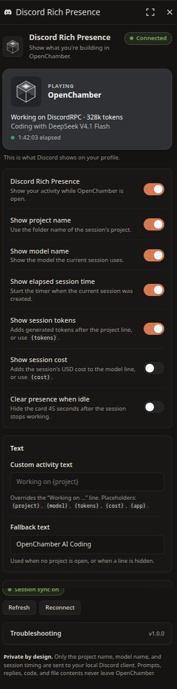

# OpenChamber Discord Rich Presence

Show your OpenChamber session on your Discord profile: the project you are working
on, the model you are coding with, generated tokens (and optionally cost), and how
long the session has been running.



This is an OpenChamber extension, not a separate app. OpenChamber starts its local
service, the service talks to the Discord desktop client over Discord's local IPC
socket, and the rail panel is only the settings and preview surface. There is no
bot token, no external server, and no network traffic to Discord beyond the local
socket.

## What it shows

```
Playing OpenChamber
Working on DiscordRPC · 6.0k tokens
Coding with DeepSeek V4.1 Flash
44:53 elapsed
```

With cost enabled:

```
Working on DiscordRPC · 6.0k tokens
Coding with DeepSeek V4.1 Flash · $0.42
```

- **Large image:** the OpenChamber logo asset (uploaded to your Discord app).
- **Large image text:** `OpenChamber AI Coding`.
- **Details:** `Working on <project> · <tokens>`, or your custom activity text
  with the same token suffix.
- **State:** `Coding with <model>`, `Idle · <model>`, or `Using OpenChamber`, with
  the optional session cost.
- **Elapsed time:** since the current session was created.

Tokens sit on the project line, so the model line stays readable. Discord only
provides two text lines; putting the usage on the first line is the closest it
gets to a separate line without losing the model.

Generated tokens are `output + reasoning`, the same measure OpenChamber shows as
generated tokens. The cost is the session's running USD cost from OpenCode. Both
are optional and configurable. Fallbacks are deliberate: with no session you see
`OpenChamber AI Coding` / `Ready`; an idle session shows `Idle · <model>`; hiding
the project, model, tokens or cost removes that part instead of inventing one.

## Requirements

- OpenChamber **2.7.1 or newer**.
- The **Discord desktop client** running on the same machine as the OpenChamber
  server (the normal desktop app setup).
- The OpenChamber Discord application. Its ID is built into the extension
  (`1571334059324477440`); there is no app-ID setting in the panel.
- Extensions load in OpenChamber web/desktop. VS Code and the mobile apps do not
  load extension services, so the presence service does not run there.

## Install

1. Open **Settings → Extensions**.
2. Choose **Folder, ZIP, or URL**, then add this folder (or its ZIP). For a folder
   install, choose the folder that contains this `package.json`.
3. Approve the permissions dialog. It asks for:
   - **Run a local service** — the process that owns the Discord connection.
   - **Read OpenCode sessions, projects, and live events** — used only for the
     project directory, model id, session timing, and aggregate token/cost usage.
4. Open the **Discord Rich Presence** icon in the OpenChamber rail. The panel shows
   whether Discord and session metadata are connected.
5. If this is the first time, do the one-time Discord app setup below.

The extension has `keepRunning: true`: after approval, the service starts with
OpenChamber and keeps the presence up even when the panel is closed.

### One-time Discord app setup

Discord Rich Presence uses the **application** you created in the
[Discord Developer Portal](https://discord.com/developers/applications). The app's
name and icon are displayed by Discord and cannot be changed by an RPC client, so
set them once in the portal:

1. Open the app with ID `1571334059324477440` (or your own app).
2. On **General Information**, rename it to **OpenChamber** if it is still named
   `openchamber`, and upload `assets/openchamber-app-icon-1024.png` as the app icon.
3. Open **Rich Presence → Art Assets** and upload
   `assets/discord-asset-openchamber.png` with the key **`openchamber`**.
   The key is built into the extension; upload it exactly as written.

If the asset is missing, the text presence still shows. When Discord rejects the
key, the service retries without the image and the panel shows a warning; some
Discord versions silently ignore an unknown key instead. The logo appears only
after the asset is uploaded under the matching key.

## Settings

Everything is in the rail panel and persists in the service's data directory
across OpenChamber restarts.

| Setting | Default | What it does |
| --- | --- | --- |
| Discord Rich Presence | on | Master switch. Turning it off disconnects RPC and clears the card. |
| Show project name | on | Uses the session's project folder name in `Working on …`. |
| Show model name | on | Uses the session's model in `Coding with …` / `Idle · …`. |
| Show elapsed session time | on | Sends the session creation timestamp as Discord's start time. |
| Show session tokens | on | Adds generated tokens (output + reasoning) after the project on the first line. |
| Show session cost | off | Adds the current session's running USD cost to the model line. |
| Clear presence when idle | off | Hides the card 45 seconds after the current session stops working. New activity brings it back. |
| Custom activity text | empty | Replaces the `Working on …` line. Placeholders: `{project}`, `{model}`, `{tokens}`, `{cost}`, `{app}`. |
| Fallback text | `OpenChamber AI Coding` | Used when there is no project, or when a line is hidden. |
`{project}`, `{model}`, `{tokens}` and `{cost}` respect the show/hide switches.
For example, with **Show model name** off, `Building {project} with {model}`
becomes `Building MyGame with`. Tokens are otherwise added after the project
line and cost after the model line. If custom text contains `{tokens}` or
`{cost}`, that stat is not added automatically, so the placeholders let you
choose exactly where it appears.

The Discord application ID, the `openchamber` large-image asset key, and the
`OpenChamber AI Coding` large-image text are built into the extension and are not
configurable from the panel.

## How it works

```
OpenChamber host
  ├─ extension service (Node, 127.0.0.1) ── Discord IPC socket ── Discord desktop
  │     ├─ sessionEvents (turn-started, turn-finished, …)
  │     ├─ OpenCode metadata + filtered event stream
  │     └─ settings.json in the service data directory
  └─ rail panel (sandboxed iframe)
        └─ POST /status, /settings, /refresh, /reconnect
```

- **Discord:** the service is a small RPC client. It speaks Discord's documented
  local IPC protocol directly (8-byte little-endian header + JSON, no third-party
  daemon) and sends `SET_ACTIVITY`. It discovers the IPC endpoint from
  `XDG_RUNTIME_DIR` / `TMPDIR` / `/tmp` on Linux and macOS, and the
  `discord-ipc-*` named pipe on Windows, including Flatpak, Snap and Vesktop
  directories.
- **Lifecycle:** OpenChamber's `contributes.sessionEvents` gives the service
  `turn-started`, `turn-finished`, `turn-failed`, `session-created`,
  `session-archived` and `session-deleted` without a window being open. The
  service declares `content: false`, so it receives identifiers and the project
  directory only — no prompts, replies, or form contents.
- **Model, project, timing and usage:** the service reads session **metadata**
  from the OpenCode server through the host-approved read-only `opencode` role.
  It uses `session.viewed`, `session.model.selected`, `session.moved`,
  `session.usage.updated`, `session.execution.*` and `session.step.started` from
  the filtered event stream. It never calls the message routes.
- **The panel** posts the chat OpenChamber is showing (session id, directory,
  model, busy flag). While it is open it is authoritative, so switching chats
  updates the card immediately even if several sessions are running. When it is
  closed, lifecycle events take over.

Presence updates are coalesced and de-duplicated. At most one RPC update is sent
per 4.2 seconds (Discord allows five per 20 seconds), and an identical payload is
never resent.

## Privacy

- Discord receives only: the project folder name, the model label, the session
  start time, generated token count, optional session cost, and the configured
  static text/asset key. Tokens and cost are aggregate numbers, never content.
- The extension never requests or transmits prompts, conversation contents,
  replies, tool input, file contents, or code snippets.
- The service's session-event subscription has `content: false`.
- No telemetry, no analytics, no external service.
- The service listens only on `127.0.0.1` and requires the per-service bearer
  token OpenChamber injects. Its settings file is mode `0600`.

## Reliability

- Discord not running is a normal state: the service waits and retries with
  exponential backoff (1 s up to 30 s, with jitter) and reconnects automatically
  when Discord restarts.
- If the OpenCode event stream drops, it reconnects and does one metadata
  reconciliation, then returns to event-driven updates.
- Missing project/model/session/usage data uses fallbacks rather than failing.
- A rejected large-image key falls back to text-only presence and warns in the
  panel.
- On `SIGTERM`/`SIGINT` the service clears the Discord card and closes cleanly.
  Errors in the child process never crash OpenChamber.

## Limitations

- **Same machine:** the service runs on the OpenChamber server. If you use a
  remote OpenChamber server, the service dials Discord on the server, not on your
  laptop. Use the extension with a local desktop OpenChamber server.
- **Discord app name and icon** must be set in the Developer Portal; RPC cannot
  change them.
- **Multiple running sessions:** the panel is the authoritative "what am I
  looking at" signal. Without it, the service follows an explicit chat view or a
  turn that starts while the shown session is idle; a background turn does not
  replace a session that is still generating. At startup it prefers the most
  recently updated session that is actually generating, then the most recently
  viewed one. A session already running before the service started is identified
  from its busy/idle timestamps.
- **Elapsed time** is the session's creation time. Reopening an old session shows
  its real age, which can be hours or days.
- **Usage is per session:** generated tokens are `output + reasoning` for the
  current session, not a project-wide total. Cost is OpenCode's running USD
  estimate; free providers and some subscriptions report `0` and therefore show
  no cost.
- **Platform coverage:** Linux with the official Discord client is tested
  end-to-end. macOS and Windows socket discovery follow the documented paths but
  were not exercised in this environment. If discovery fails, set the Discord IPC
  socket override in **Settings → Extensions** (Advanced on the extension card).
- **Asset upload** is a portal step; the logo file is included but cannot be
  uploaded without your developer credentials.
- Discord may cache a profile card for a few seconds after an update.

## Development

```bash
npm install
npm run build       # panel/main.js (IIFE) + service/main.js (ESM)
npm run package     # clean runtime folder + ZIP under dist/
npm run typecheck
npm test            # tests: framing, reconnect, tracker, settings, service E2E
```

Built files are committed because OpenChamber never compiles an extension at
install time. `src/` is the source; `panel/` and `service/` contain the runtime
output.

The tests cover:

- Discord IPC framing and partial-frame parsing.
- Handshake, `SET_ACTIVITY`, clear, coalescing, and reconnect after the mock
  Discord server restarts.
- Waiting for a Discord client that starts after the service.
- Presence text fallbacks, custom placeholders, model formatting, project names,
  generated-token formatting, cost formatting, and stats/suffix de-duplication.
- Session tracking: viewed/model/moved/usage/execution events, subagents, stale
  end events, panel authority, reconcile selection by busy/idle timestamps.
- A real spawned service against a mock Discord socket and mock OpenCode server:
  startup session selection, SSE model/project/usage changes, session events,
  idle clearing, settings persistence, unauthorized requests, malformed events,
  and the no-OpenCode fallback.

For a standalone Discord check without OpenChamber:

```bash
npm run build
node scripts/dev-service.mjs
# in another terminal:
curl -H "Authorization: Bearer dev-token" http://127.0.0.1:47123/status
```

It uses its own `/tmp` data directory and never touches the installed copy.

## Troubleshooting

**"Discord not found" in the panel**
Start the Discord desktop app. On Linux, check
`ls "$XDG_RUNTIME_DIR"/discord-ipc-*` (usually `/run/user/1000/discord-ipc-0`).
The extension card's socket binding may show as unresolved because the manifest
cannot know `XDG_RUNTIME_DIR`; the service still discovers it. If your Discord
build uses another path, set the override on the extension card in
**Settings → Extensions**, then press **Reconnect**.

**"Session metadata off"**
The extension was installed without the `opencode` read grant, or the grant was
withdrawn. Re-approve it in **Settings → Extensions**. Presence still works with
fallback text, and the open panel can supply the current project/model.

**The image is missing, or "Discord rejected the image"**
Upload `assets/discord-asset-openchamber.png` as the `openchamber` asset in the
Developer Portal. The key is fixed in the extension. The text presence continues;
some Discord versions ignore an unknown key without an error, so the panel's
preview is the best confirmation that the asset key is configured.

**"Service offline"**
Reopen the panel, or re-approve/enable the extension. The service's stdout/stderr
goes to OpenChamber's logs; it never logs prompts or file contents.

## License

MIT. See [LICENSE](LICENSE).
